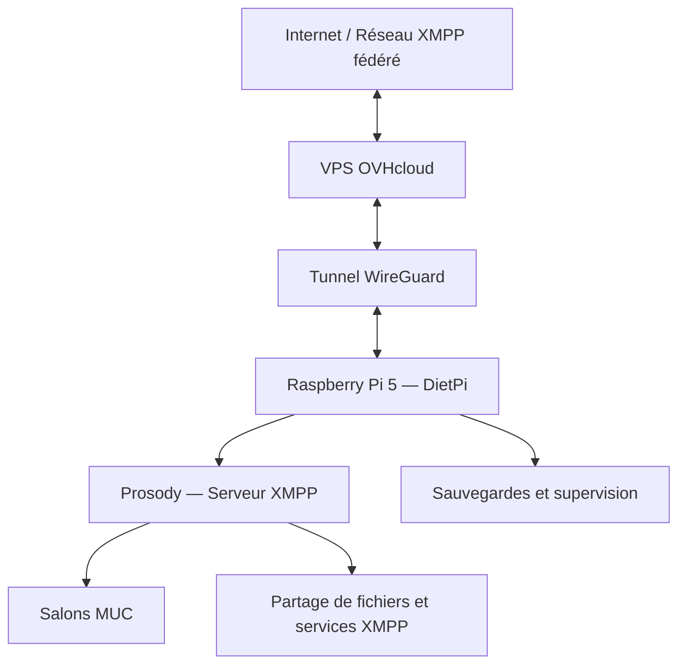

# Architecture de Carnet Noir

## Présentation

Carnet Noir est une infrastructure de communication décentralisée reposant sur un **Raspberry Pi 5 sous DietPi**, associé à un **VPS OVHcloud**.

Cette architecture permet de conserver les services principaux sur du matériel auto-hébergé tout en disposant d'un point d'entrée accessible depuis Internet.

## Schéma d'architecture

## Raspberry Pi 5

Le Raspberry Pi 5 constitue le serveur principal de Carnet Noir.

Il héberge notamment :

- **DietPi**, distribution Linux légère basée sur Debian.
- **Prosody**, serveur de messagerie XMPP.
- **Fail2ban**, pour limiter certaines tentatives d'accès abusives.
- Des procédures automatisées de sauvegarde et de notification.

## VPS OVHcloud

Le VPS fournit un point d'entrée public à l'infrastructure.

Il participe à l'acheminement des connexions depuis Internet vers les services hébergés sur le Raspberry Pi.

Cette séparation permet de dissocier le serveur applicatif du point d'entrée public.

## WireGuard

WireGuard assure une liaison réseau chiffrée entre le VPS et le Raspberry Pi.

Il permet aux deux machines de communiquer à travers un tunnel privé.

Les adresses internes et les clés cryptographiques ne sont pas publiées dans cette documentation.

## Services XMPP

Prosody fournit les principales fonctionnalités de communication :

- Messagerie instantanée fédérée.
- Salons de discussion multi-utilisateurs (MUC).
- Archivage des messages.
- Transfert de fichiers.
- Fonctionnalités nécessaires aux appels audio et vidéo.

Les salons communautaires sont hébergés sur `groups.carnetnoir.fr`.

## Sécurité et maintenance

L'infrastructure intègre plusieurs mécanismes de protection et d'exploitation :

- Communications chiffrées.
- Contrôle des accès administratifs.
- Protection contre certaines tentatives d'authentification abusives.
- Sauvegardes automatisées.
- Notifications en cas d'échec des sauvegardes.
- Vérifications régulières du fonctionnement des services.

## Principes du projet

L'architecture privilégie :

1. L'auto-hébergement.
2. L'utilisation de logiciels libres et de protocoles ouverts.
3. La maîtrise des données et des services.
4. La sobriété matérielle.
5. La documentation et la maintenabilité.

---

**Site officiel :** https://carnetnoir.fr

**Service XMPP :** carnetnoir.fr
